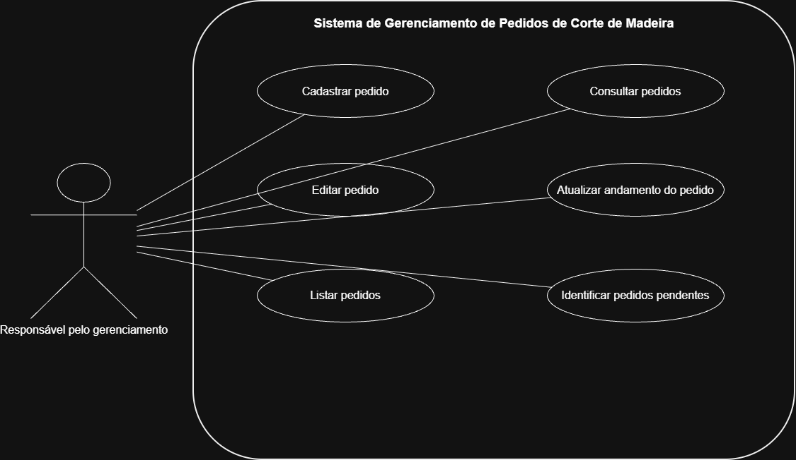

# 4.2.2 Modelagem de Casos de Uso

## 1. Atores

| Ator | Descrição |
|---|---|
| Responsável pelo gerenciamento | Pessoa que utiliza o sistema para cadastrar, consultar, editar e excluir marcas de carros. |

## 2. Casos de uso

| Código | Caso de uso | Ator | Requisito |
|---|---|---|---|
| UC01 | Cadastrar marca | Responsável pelo gerenciamento | RF01 |
| UC02 | Consultar marcas | Responsável pelo gerenciamento | RF02 |
| UC03 | Editar marca | Responsável pelo gerenciamento | RF03 |
| UC04 | Excluir marca | Responsável pelo gerenciamento | RF04 |
| UC05 | Listar marcas | Responsável pelo gerenciamento | RF05 |
| UC06 | Localizar marca | Responsável pelo gerenciamento | RF06 |

## 3. Diagrama de casos de uso

**Figura 1 — Diagrama de casos de uso do sistema.**

**Fonte:** Elaborado pelo autor.

O diagrama mostra a pessoa que utiliza o sistema e as funções disponíveis. O responsável pelo gerenciamento fica fora do retângulo, e os casos de uso ficam dentro dele. Cada elipse representa uma função do sistema.

## 4. Especificação do caso de uso principal

### UC01 — Cadastrar marca

**Ator:** Responsável pelo gerenciamento.

**Pré-condição:** O sistema está disponível para uso.

**Pós-condição:** A marca fica cadastrada no sistema.

### Fluxo principal

1. O responsável informa os dados da marca.
2. O sistema recebe os dados.
3. O sistema verifica se os dados necessários foram preenchidos. ❓
4. O sistema verifica se a marca já está cadastrada. ❓
5. O sistema salva a marca.
6. O sistema informa que o cadastro foi realizado.
7. O responsável recebe a confirmação.

### Fluxo alternativo — Dados incompletos

1. No passo 3, se faltarem dados, o sistema informa que é necessário completar o cadastro. ❓
2. O responsável completa as informações.
3. O fluxo volta ao passo 2 do fluxo principal.

### Fluxo de exceção — Erro ao cadastrar

1. No passo 5, se ocorrer um erro ao salvar a marca, o sistema informa que não foi possível realizar o cadastro.
2. O sistema não confirma o cadastro como concluído.
3. O caso de uso termina sem cadastrar a marca.

## 5. Rastreabilidade com a seção 4.2.1

| Requisito funcional | Caso de uso correspondente |
|---|---|
| RF01 — Cadastrar marca | UC01 — Cadastrar marca |
| RF02 — Consultar marcas | UC02 — Consultar marcas |
| RF03 — Editar marca | UC03 — Editar marca |
| RF04 — Excluir marca | UC04 — Excluir marca |
| RF05 — Listar marcas | UC05 — Listar marcas |
| RF06 — Localizar marca | UC06 — Localizar marca |

### Conferência

**Todos os requisitos têm um lugar?**

Sim. Todos os requisitos funcionais estão relacionados a um caso de uso.

**Todas as elipses têm um requisito?**

Sim. Cada caso de uso corresponde a um requisito funcional da seção 4.2.1.

**Algum requisito virou passo?**

Não. Todos os seis requisitos foram representados como casos de uso separados.

**O que ainda preciso confirmar?**

Preciso confirmar quais dados serão cadastrados para cada marca, quais são obrigatórios e se o sistema deve impedir marcas repetidas.

