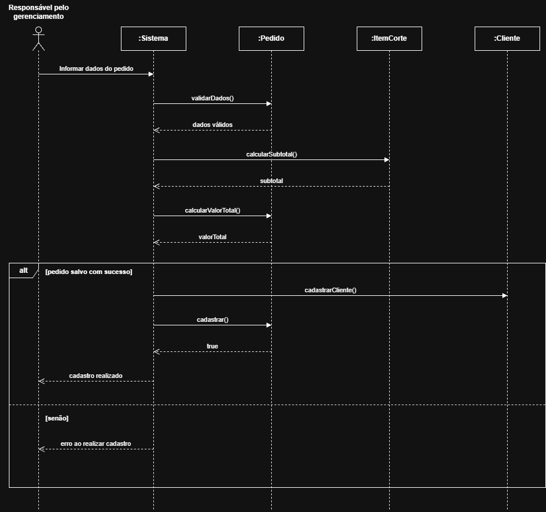

# 4.2.4 Modelagem de Sequência

> 🔒 Esta seção entra na **Aula 27**. Deixe como está até lá. Na aula, o molde chega pelo AVA, e a seção pronta do BiblioTech aparece no repositório do modelo.

## Do fluxo às mensagens

| No fluxo da 4.2.2 | Vira a mensagem | De quem para quem | Por quê |
|---|---|---|---|
| Passo 1: O responsável informa os dados do pedido | `Informar dados do pedido` | Responsável pelo gerenciamento → `:Sistema` | Passo do ator vira mensagem dele para o sistema (sem parênteses). |
| Passo 2: O sistema recebe os dados | — *(incorporado ao recebimento da mensagem anterior)* | — | O recebimento ocorre no momento em que o `:Sistema` recebe a chamada do ator. |
| Passo 3: O sistema verifica se os dados necessários foram preenchidos | `validarDados()` (e retorno `dados válidos`) | `:Sistema` → `:Pedido` (e volta para `:Sistema`) | O sistema delega à classe `Pedido` a verificação dos campos obrigatórios. |
| Passo 4 (preparação): Cálculo do subtotal e valor total do pedido | `calcularSubtotal()` e `calcularValorTotal()` (com retornos `subtotal` e `valorTotal`) | `:Sistema` → `:ItemCorte` e `:Sistema` → `:Pedido` | Antes de salvar, o sistema calcula o valor da metragem (R$ 35,00/m) e o total do pedido. |
| Passo 4: O sistema salva o pedido | `cadastrarCliente()` e `cadastrar()` (com retorno `true`) | `:Sistema` → `:Cliente` e `:Sistema` → `:Pedido` | O sistema registra o cliente e persiste o pedido no banco. |
| Passo 5: O sistema informa que o cadastro foi realizado | `cadastro realizado` | `:Sistema` → Responsável pelo gerenciamento | Retorno visual na tela confirmando que o pedido foi gravado. |
| Passo 6: O responsável recebe a confirmação | — *(concluído com o retorno anterior)* | — | O ator visualiza a mensagem de sucesso na interface e encerra o caso de uso. |
| Exceção (Erro ao cadastrar) — Passos 1 a 3 | Fragmento `alt` (`[pedido salvo com sucesso]` / `[senão]`) com retorno `erro ao realizar cadastro` | `:Sistema` → Responsável pelo gerenciamento | Entra no andar `[senão]` do fragmento `alt` quando ocorre falha ao persistir o pedido. |
| Alternativo (Dados incompletos) — Passos 1 a 3 | *Fica de fora do diagrama* | — | O diagrama de sequência modela apenas o cenário principal e uma exceção (`alt`); fluxos alternativos de repetição já estão cobertos no diagrama de atividades (4.2.5). |

---

## Diagrama de sequência

**Figura 4 – Diagrama de sequência de UC01 — Cadastrar pedido**

**Fonte:** Autoria própria (2026).

A Figura 4 apresenta **5 linhas de vida** organizadas da esquerda para a direita conforme a ordem de participação no cenário: o ator **Responsável pelo gerenciamento** (Eduardo, do lado de fora do sistema), o objeto coordenador **`:Sistema`** e três objetos das classes definidas na seção 4.2.3: **`:Pedido`**, **`:ItemCorte`** e **`:Cliente`**. As classes `Responsavel` e `StatusPedido` não possuem linha de vida própria porque o responsável já está representado como ator externo e `StatusPedido` é apenas uma enumeração utilizada como atributo.

O tempo corre de cima para baixo ao longo de **6 mensagens** (setas cheias) e **5 retornos** (setas tracejadas). A conversa inicia quando o **Responsável pelo gerenciamento** envia a mensagem `Informar dados do pedido` ao **`:Sistema`**. Em seguida, o **`:Sistema`** chama `validarDados()` em **`:Pedido`**, que devolve a confirmação `dados válidos`. Dando sequência ao cálculo da regra de negócio (R$ 35,00 por metro), o **`:Sistema`** solicita `calcularSubtotal()` a **`:ItemCorte`** (recebendo `subtotal`) e `calcularValorTotal()` a **`:Pedido`** (recebendo `valorTotal`).

Para a etapa de gravação, o **`:Sistema`** envia `cadastrarCliente()` para **`:Cliente`** e `cadastrar()` para **`:Pedido`**, que retorna `true` confirmando a persistência. Por fim, o **`:Sistema`** devolve o retorno `cadastro realizado` ao **Responsável pelo gerenciamento**. O quadro com a aba **`alt`** envolve o trecho de gravação e confirmação (`cadastrarCliente()`, `cadastrar()` e o retorno ao ator): no andar superior (**`[pedido salvo com sucesso]`**), o fluxo conclui o cadastro normalmente; no andar inferior (**`[senão]`**), representando a exceção *Erro ao cadastrar* da 4.2.2, o **`:Sistema`** envia o retorno tracejado `erro ao realizar cadastro` ao ator e nenhum registro é efetivado.

---

## Rastreabilidade com a 4.2.3

| Mensagem | Chega em | Operação na 4.2.3 | Passo da 4.2.2 |
|---|---|---|---|
| `validarDados()` | `:Pedido` | ❓ *(não existe na 4.2.3)* | UC01 — Fluxo principal, Passo 3 |
| `calcularSubtotal()` | `:ItemCorte` | `+ calcularSubtotal(): double` | UC01 — Fluxo principal, Passo 4 *(implícito)* |
| `calcularValorTotal()` | `:Pedido` | `+ calcularValorTotal(): double` | UC01 — Fluxo principal, Passo 4 *(implícito)* |
| `cadastrarCliente()` | `:Cliente` | `+ cadastrarCliente(): void` | UC01 — Fluxo principal, Passo 4 |
| `cadastrar()` | `:Pedido` | `+ cadastrar(): boolean` | UC01 — Fluxo principal, Passo 4 |

### Conferência
* **Toda mensagem com parênteses chega em quem tem a operação?** Quase todas. As operações `calcularSubtotal()`, `calcularValorTotal()`, `cadastrarCliente()` e `cadastrar()` existem exatamente com esses nomes nas suas respectivas classes na 4.2.3. A única exceção é `validarDados()`, marcada com **❓**, que foi identificada como necessária na classe `Pedido` durante a modelagem de sequência e será adicionada como nota na 4.2.3.
* **Todo passo tem mensagem?** Sim. Todos os passos de ação do ator e de processamento do sistema no fluxo principal do UC01 estão representados na ordem cronológica de cima para baixo.
* **O que o desenho mudou nas suas classes?** O desenho testou as classes em execução e revelou a necessidade de explicitar a operação `+ validarDados(): boolean` na classe `Pedido` (para atender ao Passo 3 da especificação) e confirmar que `calcularSubtotal()` e `calcularValorTotal()` são chamadas antes da persistência (`cadastrar()`), resolvendo a lacuna observada anteriormente no diagrama de atividades.
